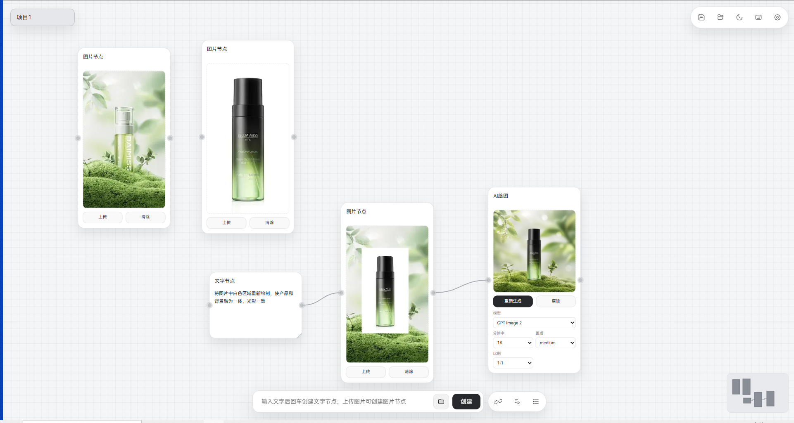
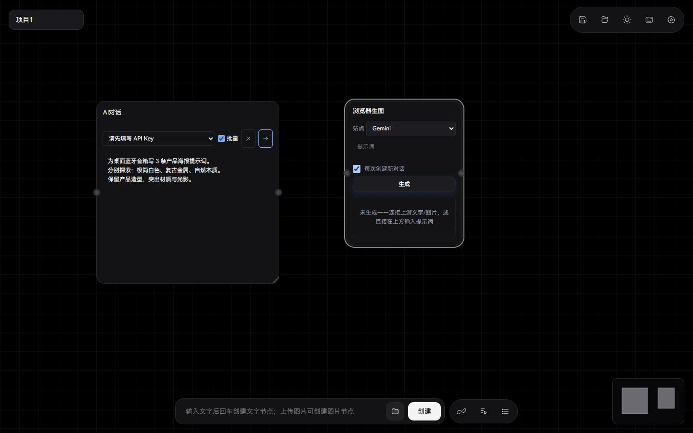
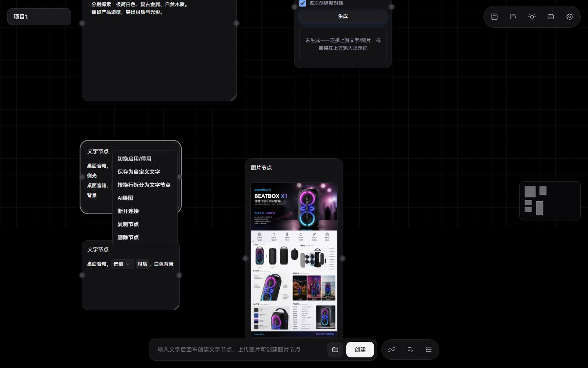
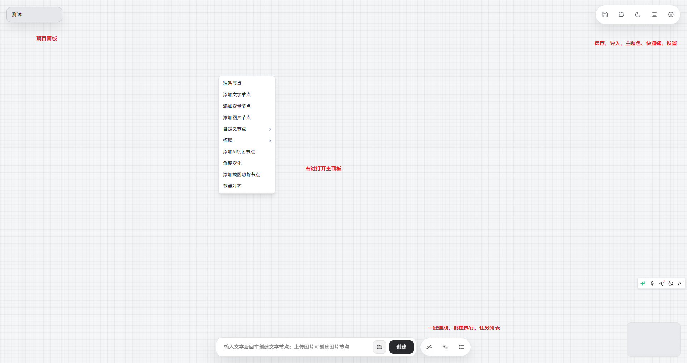
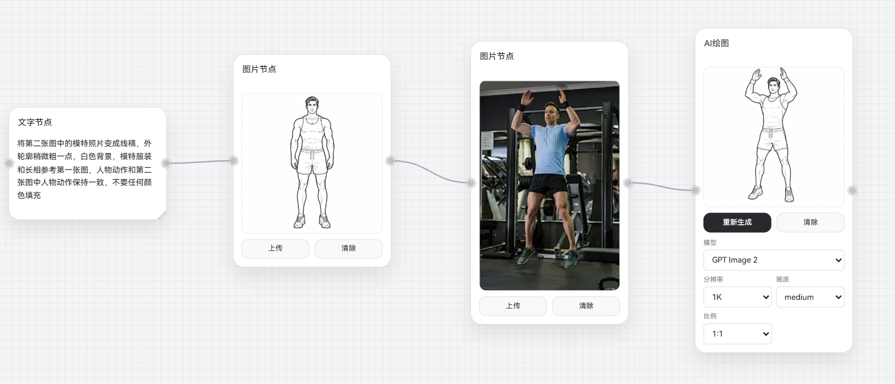
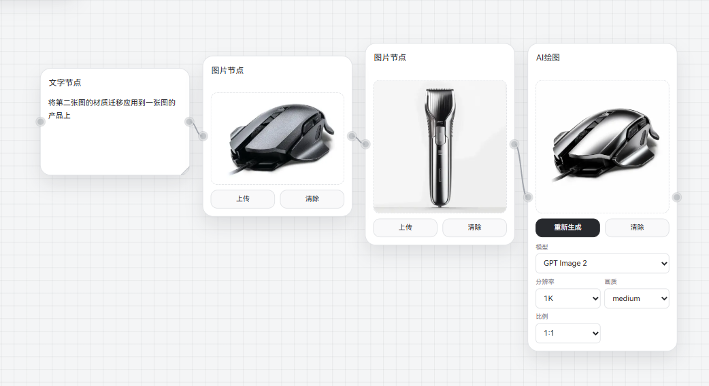
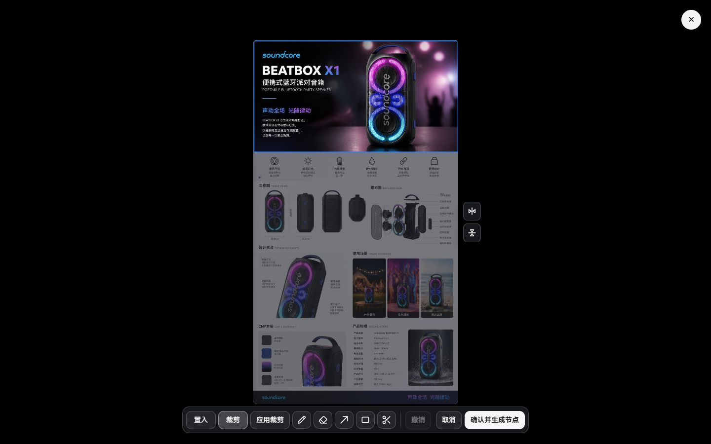
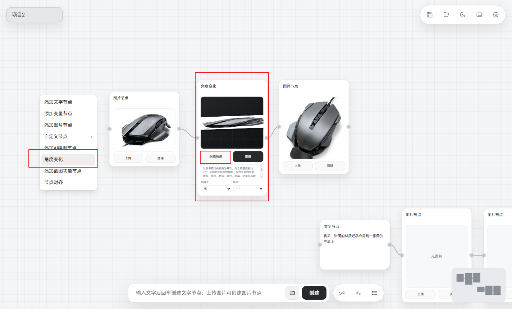
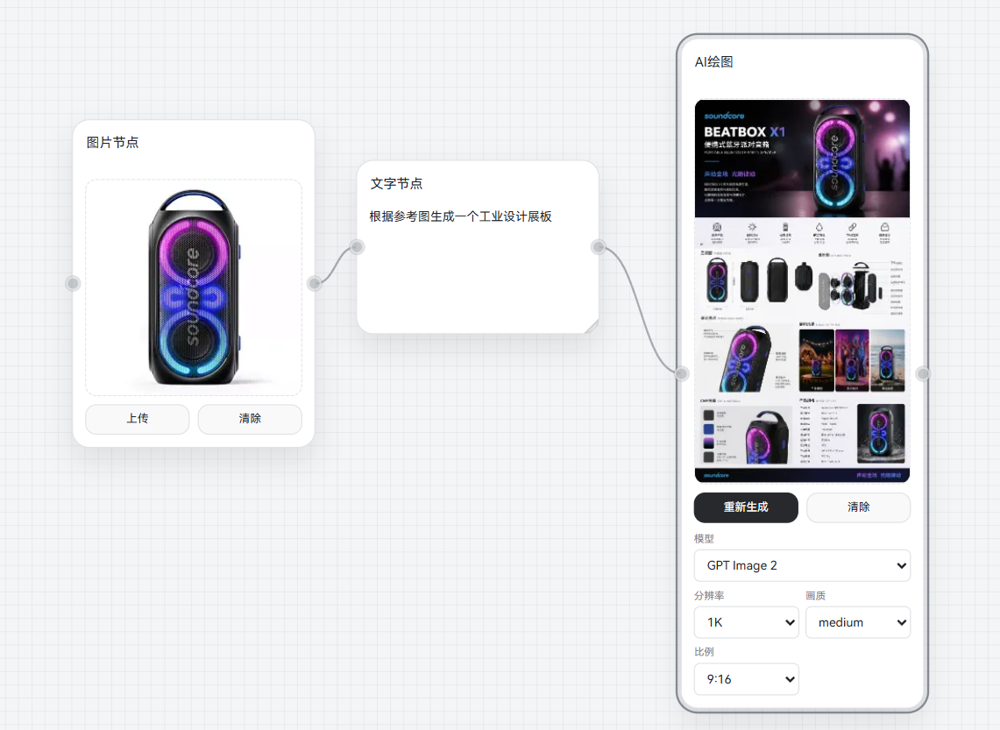
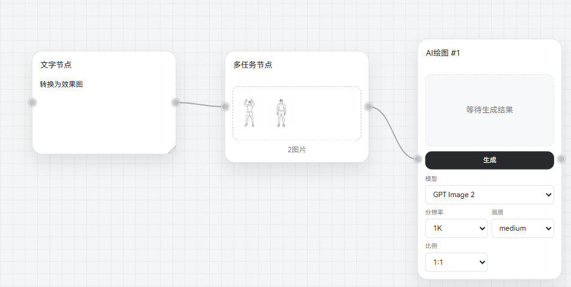

<div align="center">


# CanvasFlow

**面向产品设计与视觉创作的可视化 AI 图片工作流工具**

把参考图片、提示词和 AI 生成结果连接在同一张画布上。<br />
从线稿到效果图，从 CMF 探索到场景融合、海报与批量出图，让设计思路沿着节点展开。

[](https://github.com/wuxinliuyun-art/canvasflow/releases/latest)
[](LICENSE)


[下载最新版](https://github.com/wuxinliuyun-art/canvasflow/releases/latest) · [快速开始](#快速开始) · [图文教程](https://my.feishu.cn/wiki/HHV9wswCmiCPxDk4ruKcKWuCnVe) · [视频教程](https://space.bilibili.com/38246447) · [版本更新](https://github.com/wuxinliuyun-art/canvasflow/releases) · [问题反馈](https://github.com/wuxinliuyun-art/canvasflow/issues)

简体中文 · [English](README_EN.md)



</div>

## 用 CanvasFlow 做什么？

CanvasFlow 在本地运行，通过拖动节点和连接素材组织 AI 图片工作流，无需编程。你可以保留每一步的输入、关键词和结果，在同一画布中比较方案、调整细节并复用流程。

| 设计场景 | 使用方式 |
| --- | --- |
| 图片转线稿 | 提取参考图的轮廓与结构，作为后续效果图的输入 |
| CMF 探索 | 结合产品图和材质参考，尝试不同颜色、材质与表面工艺 |
| 模特图与场景图 | 将产品与人物、背景参考组合，探索展示方式和视觉氛围 |
| 图片编辑 | 裁剪图片、置入素材、镜像和笔刷标注，再生成独立图片节点 |
| 角度变化 | 根据参考图尝试不同观察角度，辅助比较造型 |
| 海报与批量出图 | 组织产品、文案和视觉参考，复用提示词处理多张图片 |

## 近期新增功能与交互

以下介绍近期迭代及当前仓库开发版的能力。安装包以 [Releases](https://github.com/wuxinliuyun-art/canvasflow/releases) 中对应版本的说明为准；源码更新不代表安装包已经更新。

| 功能 | 怎样使用 |
| --- | --- |
| AI 对话节点 | 在画布内编写和调整提示词，支持上游文字输入；多模态模型还可参考图片 |
| 批量提示词 | 对话节点勾选“批量”，让模型输出编号方案；回复中有至少两条编号内容时，自动拆成文字节点 |
| 浏览器生图 | 通过 Chrome 扩展连接 Gemini、ChatGPT 或自定义站点，将结果带回画布 |
| 图片裁剪 | 在图片编辑器拖框选择保留区域，应用裁剪后可撤销、继续编辑并生成新节点 |
| 文字拆分与合并 | 多行文字右键按换行拆分；拖动有内容的文字节点与另一文字节点重叠，可合并文案 |
| 内嵌变量 | 在文字中写入变量名，就能直接选择变量值，并按需要启用或停用 |
| 素材与变量排序 | 通过拖动调整素材、组件与变量的排列顺序 |
| 连线手势 | 长按节点后拖入连线可插入流程；长按不移动再松开，可隔离节点并接通前后连线 |
| 生成与保存 | 绘图模型支持选择生成张数，任务运行期间可切换项目；生成图片可按项目名归档 |
| 桌面协作 | 支持 Photoshop 图片互传与自定义组件；macOS 壳源码已入库，与 Windows 共用界面热更新包 |

### 在画布中准备提示词，再选择生成方式

AI 对话节点保留可编辑的关键词区，并用最新回复替换结果区。Enter 发送、Shift+Enter 换行，也可以点击发送或停止。对话结果可连接到下游绘图节点；“批量”适合一次探索多个方案。

浏览器生图需要先安装 [CanvasFlow Chrome 扩展](browser-extension/README.md)，并登录目标站点。支持继续当前对话或每次创建新对话，上游最多提供四张参考图；浏览器任务串行执行，遇到验证或限流时需手动处理。站点页面改版后可用扩展的校准入口重新选择输入框和发送按钮。



上图展示实际控件与示例输入，尚未填写 API Key 或执行生成。

### 把提示词拆开、组合和复用

文字节点中写入变量名后，可以在文案内切换对应值。两行以上的文字可右键选择“按换行拆分为文字节点”；文字重叠合并可在“设置 → 常规”独立开关，不受图片重叠编辑开关影响。



素材库中的文字、图片与自定义组件可以保存复用，并拖动调整顺序。生成图片的项目归档开关位于“设置 → 保存”，默认模型、分辨率和比例位于 AI 绘图设置。

## 快速开始

### 1. 下载并运行

1. 打开 [GitHub Releases](https://github.com/wuxinliuyun-art/canvasflow/releases/latest)。
2. 下载并运行 `CanvasFlow-Setup.exe`。
3. 按提示完成当前用户安装，然后从桌面或开始菜单启动 CanvasFlow。
4. 启动后直接进入 CanvasFlow 主画板。

macOS 用户在同一 Release 中选择对应架构的 mac 压缩包（Intel / Apple Silicon），解压后将 `CanvasFlow.app` 放入 Applications。源码构建说明见 [macOS 桌面版文档](desktop-mac/README.md)。

> 当前安装包尚未使用商业代码签名。首次运行时 Windows 或杀毒软件仍可能要求确认，请先确认文件来自本项目官方 Release。

### 2. 填写 API Key

1. 点击右上角的齿轮按钮。
2. 进入“AI 绘图”设置。
3. 选择需要使用的 API 服务，填写该服务对应的 API Key 并保存。CanvasFlow 支持 APIMart 和 agtoken，两家的 Key 分别配置。

[注册获取 API](https://apimart.ai/register?aff=W5d401)

> API Key 保存在当前电脑中，不会写入项目自动备份。

桌面版会使用 Windows 安全存储加密 API Key；如果系统安全存储不可用，程序会提示并只在本次运行中保留。

### 3. 创建节点

在画布空白位置点击鼠标右键，可以创建文字、图片、AI 绘图、AI 对话、角度变化、多任务和截图功能节点，也可以插入已经保存的自定义素材与组件。文字节点中使用变量库的变量名时，可以通过节点内的下拉选项选择变量值。

图片还可以直接从电脑拖入画布，或复制后粘贴。

### 4. 连接并生成图片

```text
文字节点 ─┐
          ├─→ AI 绘图节点 ─→ 生成的图片节点
图片节点 ─┘
```

1. 在文字节点中输入想生成的画面。
2. 在图片节点中上传参考图片。
3. 将文字和图片连接到 AI 绘图节点。
4. 在 AI 绘图节点中选择模型、分辨率、画质和比例。
5. 点击“生成”。

只连接文字节点时可以进行文字生图；同时连接图片节点时，AI 会参考输入图片生成。结果可以显示在 AI 节点预览中，也可以按设置生成独立图片节点，继续连接到下一步。



## 功能实览

以下工作流配图来自 [CanvasFlow 绘图工具使用说明](https://my.feishu.cn/wiki/HHV9wswCmiCPxDk4ruKcKWuCnVe)，图片编辑配图更新为当前开发版实测截图。其余截图中的界面和模型名称可能与当前版本略有差异。

### 图片转线稿

将参考图片转换为线稿，提取轮廓与造型信息，再连接到后续绘图节点。常用提示词可以保存到素材库，随时复用。



### CMF 与材质探索

同时提供产品图和材质参考，通过提示词说明需要迁移的颜色、材质或表面效果，快速比较不同方案。



### 产品与场景融合

把产品图置入背景后，可使用“将图片中白色区域重新绘制，使产品和背景融为一体，光影一致”等提示词继续生成。首页配图展示了从参考素材到融合结果的完整流程。

### 图片编辑与裁剪

双击图片进入编辑器，可以置入图片、镜像、使用画笔或橡皮擦，也可以用箭头与方框标注。拖动两张图片重叠，在出现外轮廓后松开，也能进入图片编辑流程。

点击“裁剪”，拖框选择需要保留的区域，再点“应用裁剪”。裁剪支持撤销和连续操作，完成后可以继续绘制或置入素材；点击“确认并生成节点”创建新图片，原图片保留。



### 角度变化

连接参考图，在角度变化节点中调整水平、俯仰、滚转与缩放，再生成新的视角。该功能依靠 AI 重新绘制，大角度变化和遮挡区域可能产生偏差。



### 海报生成

将产品参考、文案与画面要求组织为节点，尝试不同构图、背景和视觉风格，并保留结果进行比较。



### 批量处理与流程复用

框选多个图片节点后，可以右键创建多任务节点，复用同一份提示词处理多张图片。框选一组节点并保存为自定义组件后，可以在其他流程中再次调用。



画布中有多个 AI 绘图节点时，可通过底部批量执行入口提交任务；不需要执行的节点可以先右键停用。任务队列最多同时处理 5 个任务。

### 几个实用技巧

- 剪贴板中的图片可以直接粘贴到画布，也可以从电脑拖入。
- 在底部文本框输入文字，可以快速创建文字节点。
- 多张参考图按画布从左到右的顺序组织，便于用“第一张”“第二张”明确指定主体或材质参考。
- 框选节点后使用底部一键连接工具，可以减少逐条拉线。
- Windows 桌面版的截图窗口可把 Rhino 等软件中的指定区域直接作为 AI 参考图。

---

## 核心功能

### 可视化节点画布

- 通过节点和连线组织图片生成流程
- 支持拖动、框选、复制、粘贴、删除、撤销和重做
- 支持网格吸附、画布缩放、小地图和多任务
- 点击左下角键盘图标可查看快捷键

### AI 图片生成

- 支持文字生图、文字加参考图和多张参考图
- 每个 AI 绘图节点单独设置模型、分辨率、画质和比例
- 多个节点可以分别执行任务并独立显示进度
- 生成结果支持节点预览或独立图片节点，可继续连接和处理
- 网络连接失败或接口返回 `500 / 502 / 503 / 504` 时自动尝试备用 API 地址；`401 / 403` 会直接提示检查 API Key

### 任务队列

- AI 绘图任务统一显示在右侧任务队列中，最多同时处理 5 个任务
- 可以查看任务缩略图、关键词和状态；尚未发送的等待任务支持暂停、恢复和删除
- 运行中的任务会继续完成，避免中途终止造成重复扣费或结果丢失

### 截图工具

- Windows 桌面版提供独立置顶截图窗口，可框选固定屏幕区域并直接发送 AI 绘图任务
- 可以复用自定义文字，或使用画布中的“截图功能节点”提供文字和参考图片
- 截图始终作为第一张参考图；生成结果自动保存到 `export\ai_generated\`
- 截图窗口支持折叠、预览结果、双击放大，以及右键复制生成图片

### 批量生成

多个 AI 绘图节点可以同时运行。使用多张参考图片或多任务图片时，每张结果都会单独显示，方便继续选择、连接和处理。

### 自定义素材

- 保存经常使用的整段文字和参考图片
- 从画布右键菜单快速创建
- 所有项目共用本机素材库
- 从素材库创建的节点是普通独立副本
- 修改或删除素材不会影响已经创建的节点
- 自定义图片支持双击放大预览

首次使用且素材库为空时，CanvasFlow 会提供“图片转线稿”和“多视角参考”两条示例文字素材。

### 变量库与文字节点

- 在“设置 → 变量库”定义所有项目共用的变量和单选值
- 在文字节点中输入变量名，节点会显示对应的变量选项下拉条
- 所选变量按“值+变量名”输出，例如选择塑料材质、哑铃产品后，提示词中对应变量会展开为“塑料材质，哑铃产品”
- 已有项目中的独立变量组合节点继续兼容
- 删除已使用的变量或选项时，节点保留原值并标记失效，不会静默改变提示词

### 角度变化

- 连接一张参考图片并重新生成不同观察角度
- 水平、俯仰和滚转均支持 `-180°～180°`
- 支持缩放和反转自动关键词中的左右方向
- 关键词以原图当前视角为基准
- 生成结果可继续作为下游参考图使用

> 该功能由 AI 根据参考图重新生成，并不是严格的三维模型旋转。复杂物体、遮挡区域和大角度变化可能产生偏差。

### 图片操作与界面

- 支持上传、拖入、粘贴、替换和清除图片
- 支持双击放大预览和保存为自定义素材
- AI 生成的图片节点支持右键复制图片，可直接粘贴到其他软件
- 支持简体中文与 English，语言选择会自动保留
- 支持项目自动保存和 GitHub Release 更新检查

---

## 保存位置与常见问题

### 生成的图片在哪里？

AI 生成成功后，图片会显示在画布中，同时自动保存到：

```text
CanvasFlow 所在文件夹\export\ai_generated\
```

例如 CanvasFlow 安装在 `D:\CanvasFlow\`，主程序位于 `D:\CanvasFlow\app\CanvasFlow.exe`，生成图片默认保存在 `D:\CanvasFlow\export\ai_generated\`。

需要集中整理结果时，可以使用画板的“导出”功能。

### 项目保存在哪里？

项目自动备份保存在：

```text
CanvasFlow 所在文件夹\download\自动备份\
```

自动备份使用当前项目名称，同名项目后续保存会覆盖旧文件，每个项目名称只保留最新版本。也可以使用顶部保存按钮手动保存项目 JSON。

### 自定义素材保存在哪里？

自定义文字和图片保存在 CanvasFlow 本地数据目录中，只供当前电脑使用，不会上传到 GitHub，也不会预置在安装包中。

`data/custom-library.json` 是程序运行后自动生成的本地素材配置，不是发布包自带文件。

### 安装包无法运行怎么办？

- 检查 Windows 或杀毒软件是否阻止程序运行。
- 确认文件来自本项目官方 Release。

### 关闭窗口后程序为什么还在？

关闭主窗口前，CanvasFlow 会先保存当前状态和项目自动备份；保存失败时会阻止退出并显示提示。

### AI 图片生成失败怎么办？

请检查 API Key、网络连接、令牌余额，以及当前模型是否支持所选分辨率和比例。网络失败或上游返回 `500 / 502 / 503 / 504` 时，CanvasFlow 会自动尝试备用地址；`401 / 403` 表示 API Key 无效或没有权限，需要重新验证或填写 Key。

### 为什么不能直接打开图片文件夹？

部分杀毒软件会阻止程序启动 Windows 文件资源管理器。可以复制设置中显示的完整路径，再粘贴到资源管理器地址栏打开。

### 如何更新 CanvasFlow？

CanvasFlow 会检查 GitHub Releases。Release 包含 `CanvasFlow-Web.zip` 时，可在设置中直接热更新界面：程序会先保存项目、校验 GitHub SHA-256、校验包内每个文件，再原子切换并重载；启动时若新版损坏会回退上一版。涉及 .NET 宿主变化时请下载 `CanvasFlow-Setup.exe` 完整更新。

---

## 下载与反馈

### 下载最新版

[下载 CanvasFlow Windows 版](https://github.com/wuxinliuyun-art/canvasflow/releases/latest)

请选择 `CanvasFlow-Setup.exe`。GitHub 自动显示的 Source code 文件是项目源码，普通用户不需要下载。

### 问题反馈

如遇到问题，请前往 [GitHub Issues](https://github.com/wuxinliuyun-art/canvasflow/issues)，并尽量提供问题截图、操作步骤、CanvasFlow 版本、浏览器控制台错误，以及是否安装了杀毒软件。

### 数据与隐私

- CanvasFlow 在本地运行，项目和自定义素材保存在当前电脑。
- API Key 使用 Windows 安全存储加密，不会写入项目或自动备份。
- 使用 AI 生成功能时，输入文字和参考图片会发送给用户配置的 API 服务。
- 请勿上传包含隐私、机密或无权使用的图片。

完整说明见 [CanvasFlow 隐私政策](PRIVACY.md)。

---

## 开发说明

CanvasFlow 由作者发起、设计并维护，项目的代码实现、界面迭代、调试与文档编写由 OpenAI Codex 协助完成。这是一个由作者主导、AI 深度参与开发的开源项目。

---

## 许可证

CanvasFlow 使用 [MIT License](LICENSE) 开源。

你可以自由使用、修改和分发本项目，包括用于商业用途，但需要保留原作者的版权和许可证声明。本软件按“原样”提供，作者不对使用过程中产生的损失承担担保责任。

CanvasFlow 调用的第三方 AI API、模型及生成内容，仍需遵守相应服务商的使用条款。

---

[最新版本](https://github.com/wuxinliuyun-art/canvasflow/releases/latest) · [问题反馈](https://github.com/wuxinliuyun-art/canvasflow/issues) · [English](README_EN.md)

开发者可查看 [源码运行与构建说明](SOURCE_SETUP.md)。
